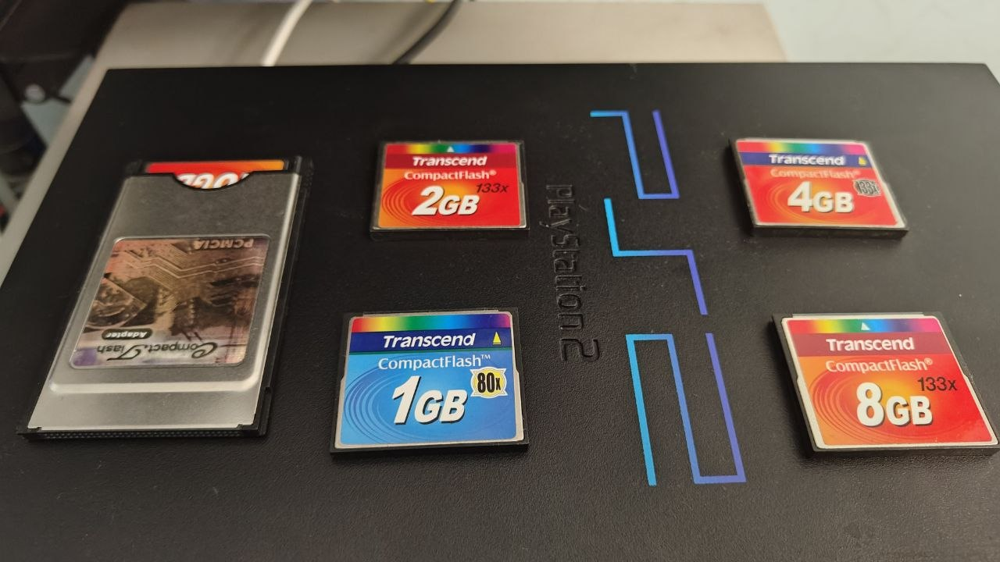
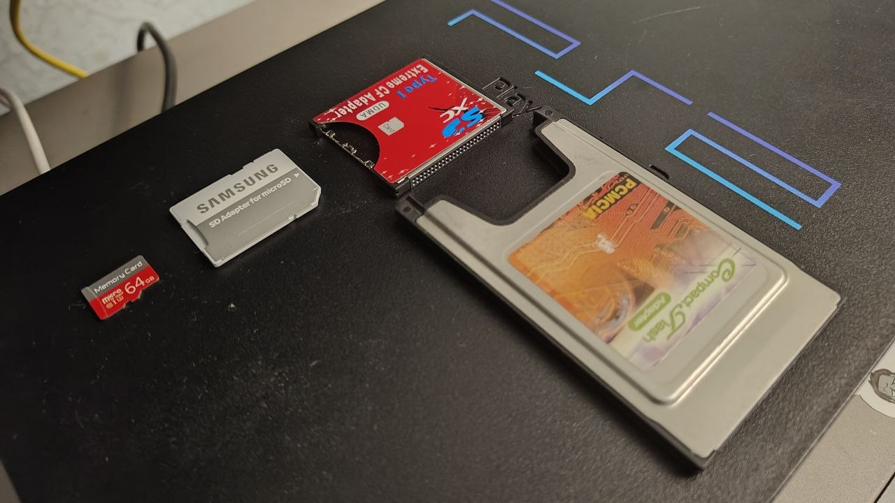
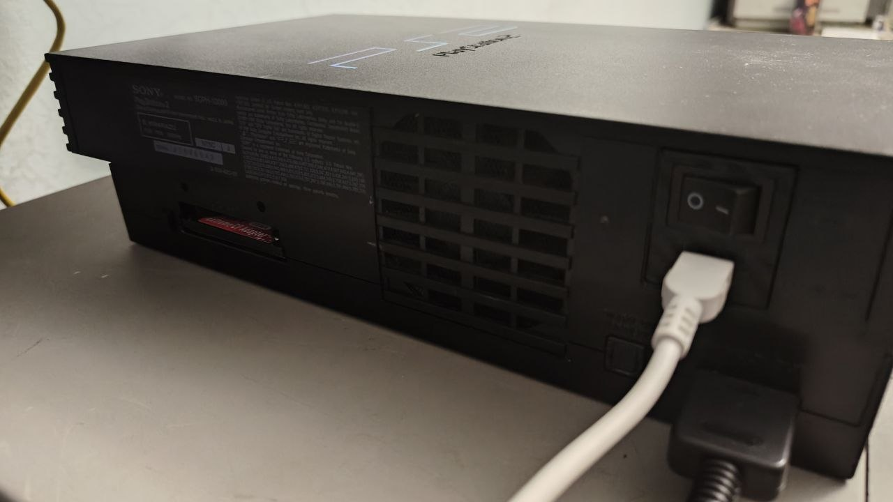
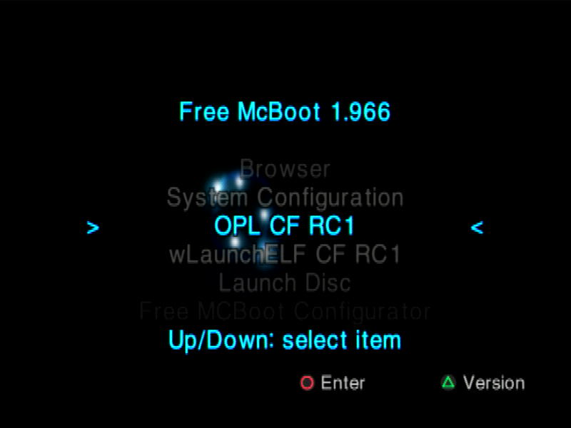
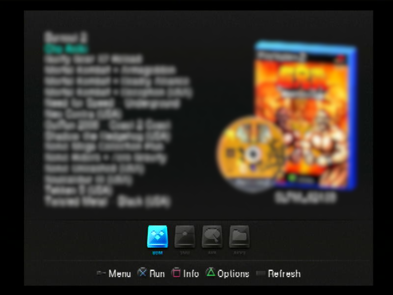
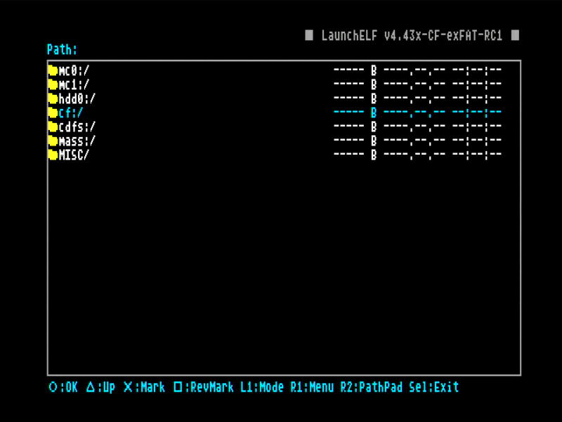
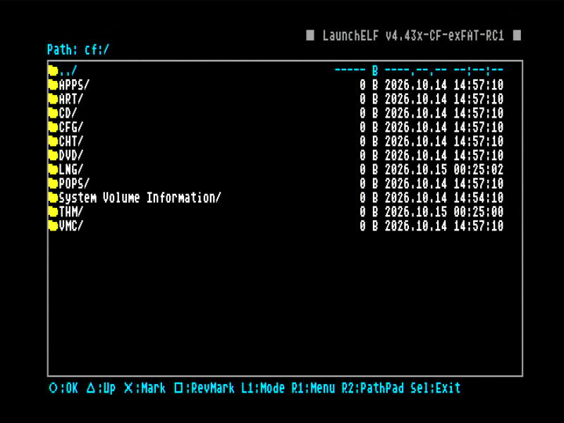
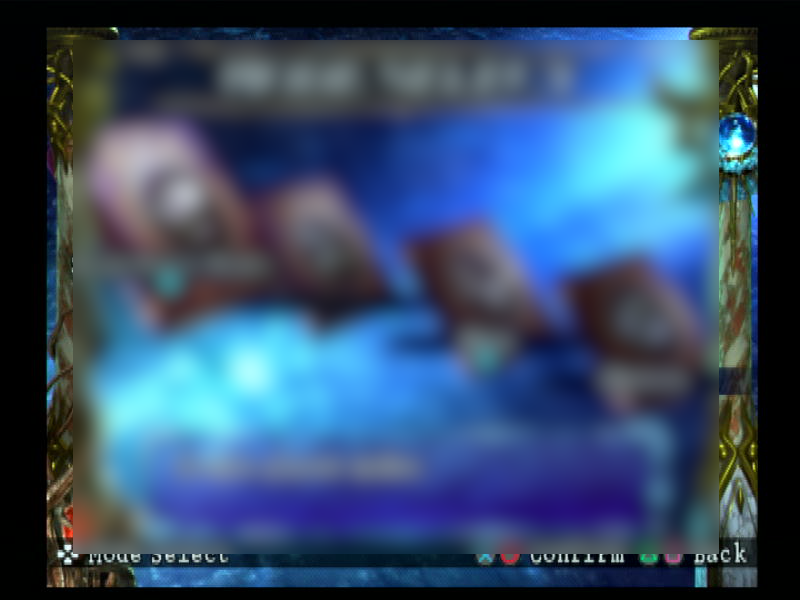

# PS2CF — Release 1.0

**[English](README.md) | [Русский](README_RU.md)**

**Play PS2 games from CompactFlash or MicroSD through the built-in PC CARD slot on early PlayStation 2 consoles.**

PS2CF adds CompactFlash support to Open PS2 Loader and wLaunchELF. It targets early
Japanese PS2 consoles with a PC CARD slot. Connect a CF card through a PCMCIA-to-CF
adapter, or use an additional SD-to-CF adapter for SD/MicroSD. Loading games from this
storage does not require a USB drive, a network server, or an external HDD.

Release 1.0 combines **OPL CF v1**, **wLaunchELF CF v1**, a customized **Free McBoot 1.966**
installer, and a bootable **PSxMemCard Gen2** image. The OPL and wLaunchELF ELF files
can also be launched separately if your console already runs homebrew.



## Consoles and hardware

| Model | Status |
| --- | --- |
| **SCPH-10000** | Main test console; used for benchmarks and game testing |
| **SCPH-15000** | Target PC CARD model; a separate hardware test has not been confirmed |
| **SCPH-18000** | Target PC CARD model; a separate hardware test has not been confirmed |

Consoles with an Expansion Bay instead of PC CARD, and Slim models, are not the target
platform for this CF driver. The bundled FMCB image targets SCPH-10000, including the
kernel updates required by ROM 1.00J and 1.01J.

You need:

- A compatible PS2 with its built-in PC CARD slot.
- A PC CARD / PCMCIA Type II-to-CompactFlash adapter supporting CF/ATA.
- A CF card, or a compatible SD-to-CF adapter with an SD/MicroSD card.
- A homebrew entry point: an existing FMCB installation or a bootable PSxMemCard Gen2.
- A memory card for saves: a normal PS2 MagicGate card or a compatible memory card emulator.

Testing covered real CF cards and a 64 GB MicroSD card through an INIC-2051 bridge.
Compatibility with every SD-to-CF adapter is not guaranteed.





## Features

- Launch PS2 games from CF or MicroSD through a CF adapter in OPL.
- **FAT32 and exFAT** read/write support.
- Single ISO files larger than 4 GiB on exFAT: Soulcalibur III was tested with a 4,384,325,632-byte image.
- **`cf:/`** in wLaunchELF for copying files, creating folders, renaming, and deleting.
- Faster PIO reads with profile validation and a conservative fallback.
- LBA48 support when supported by both the storage device and adapter.
- OPL **Write Operations = On** by default. An existing saved Off setting takes precedence.
- Standard OPL PNG artwork, per-game settings, and compatibility modes.

In successfully tested games, FMVs play smoothly without noticeable slowdowns, and
gameplay has no observed stuttering. Some games require OPL compatibility settings;
the tested games and current limitations are described below.

This version transfers data through PC CARD using **PIO, not DMA**.

## Release 1.0 downloads

Download the following assets from this repository's **Releases** page:

| Archive | Contents |
| --- | --- |
| `PS2CF-1.0-release.zip` | FMCB installer with our applications and menu; PSxMemCard Gen2 image; standalone OPL CF v1 and wLaunchELF CF v1 ELF files; documentation and SHA256 checksums |
| `PS2CF-1.0-source.zip` | Modified sources, included dependencies, build scripts, and build instructions |
| `PS2CF-1.0-source.tar.gz` | The same source tree as a tar.gz archive |

The FMCB installation contains only two user applications: **OPL CF v1** and
**wLaunchELF CF v1**. FMCB Configurator and the necessary system components are retained.
Game images and PS2 BIOS files are not included.

## Prepare CF or MicroSD storage

1. Connect the storage to a computer. Prepare a MicroSD card before inserting it into the SD-to-CF adapter.
2. Use one primary **MBR** partition formatted as **exFAT** or **FAT32**. Choose exFAT
   for single ISO files larger than 4 GiB. Formatting erases existing data.
3. Create `DVD` and `CD` folders at the root.
4. Copy DVD game ISOs into `DVD` and CD game ISOs into `CD`.
5. Safely eject the storage, then insert the adapter with the PS2 powered off.

Example:

```text
CF or MicroSD
├── DVD/
│   ├── Soulcalibur III (USA).iso
│   └── Game name.iso
├── CD/
│   └── CD game.iso
├── ART/
└── CFG/
```

For initial testing, use **ordinary, uncompressed `.iso` files** with simple names.
The filename does not have to contain the game ID: OPL can read it from the image.
The older `SLUS_212.16.Soulcalibur III.iso` naming format is supported as well.
Extract ZIP/7z/RAR archives on your computer. Renaming BIN/CUE files to ISO does not
convert them. Copy game images as normal files; do not write them as raw CF disk images.

Large ISOs do not need splitting on exFAT. FAT32 limits individual files to 4 GiB minus
one byte; exFAT is more convenient for larger games. If OPL reports unsupported
fragmentation, copy the game again to storage with sufficient contiguous free space,
after backing up any necessary data.

## Install on PSxMemCard Gen2

The supplied image does not require running the FMCB installer on a console.

1. Power off the PS2 and connect **the Gen2's own microSD card** to your computer.
2. Back up the existing `MemoryCards/PS2/BOOT/BootCard-1.mcd` separately.
3. Copy the PS2CF image from `Gen2/MemoryCards/PS2/BOOT/BootCard-1.mcd` in the release
   package to the same path on the Gen2 microSD:

   ```text
   MemoryCards/PS2/BOOT/BootCard-1.mcd
   ```

4. Return the microSD to the Gen2, insert the device into slot 1, and select boot
   channel 1. Enable BootCard autoboot if it is disabled.
5. Turn on the console and select **OPL CF v1**.

The game MicroSD belongs in the **CF adapter**. The microSD holding the `.mcd` belongs
in the **PSxMemCard Gen2**. These are separate storage devices with different purposes.

FMCB menu:

```text
Browser
System Configuration
OPL CF v1
wLaunchELF CF v1
Launch Disc
Free MCBoot Configurator
Restart System
Shutdown System
```

The menu uses plain text compatible with the early SCPH-10000 OSD, avoiding literal
formatting commands in the cursors and header. Hold R1 during FMCB startup to launch
wLaunchELF, or Start for FMCB Configurator.



## Install on an 8 MB MagicGate memory card

If FMCB already boots from a PSxMemCard or another card, use the prepared **FMCBInstaller**
to install this setup on the MagicGate card. The installer binds the bootloader to
the target card. The Gen2 `.mcd` is intended for the Gen2.

1. Copy the contents of the release's `FMCBInstaller` folder to a FAT32 USB drive.
   `FMCBInstaller.elf`, `INSTALL`, and `lang` must be alongside one another.
2. With the PS2 off, leave the boot card in slot 1, put the target MagicGate card
   in slot 2, and connect the USB drive.
3. Boot the existing FMCB, open wLaunchELF, and run the installer from `mass:/`.
4. Select **Install**, then **Slot 2** when prompted. Check the slot number in the
   confirmation. If only one card is detected, the installer selects it automatically.
5. Select a normal installation for this console. Use an empty card for a clean
   installation; back up its contents first if formatting is needed.
6. If asked to retain the old FMCB configuration, decline so that the PS2CF menu is installed.
7. When finished, power off, remove the old boot card and USB drive, move the
   MagicGate card to slot 1, and test booting from it alone.

## Use OPL and wLaunchELF

In OPL, open the BDM game list and select a game from CF. Use **Select** to refresh
the list and **Triangle** for per-game settings.

For artwork, enable **Start → Display Settings → Cover Art → On**, then save settings.
PNG files belong in `ART`, alongside `DVD` and `CD`; for example,
`ART/SLUS_212.16_COV.png` for the corresponding Soulcalibur III release.
This build loads PNG files; changing a JPG extension to PNG does not convert the image.

In wLaunchELF, open **`cf:/`** for file operations on FAT32 or exFAT. Launch ELF
applications from a memory card or USB drive: direct ELF launching from `cf:/`
is not supported in this version.



<details>
<summary>More screenshots</summary>







</details>

## Performance

Approximate benchmark results on SCPH-10000:

| Storage | Sequential reads into RAM | Reading a 32 MiB file through FAT |
| --- | ---: | ---: |
| 64 GB MicroSD through INIC-2051 | **5.20 MB/s** | **4.90 MB/s** |
| 16 GB Transcend TS16GCF133 CompactFlash | **6.93 MB/s** | **3.74 MB/s** |

MB/s is decimal. These measurements came from the PIO v30 diagnostic build before
OPL integration. They measure reads, not guaranteed game performance or CF-to-USB
copy speed. File timings excluded writes to USB. Checksums were used to verify the
data. Results depend on the card, bridge, and file layout.

The practical result in compatible tested games is smooth FMV playback and gameplay
without observed stuttering. No separate numerical in-game OPL benchmark has been performed.

## Game compatibility

These games ran on MicroSD through a CF adapter without observed problems:

- Guilty Gear X2 Reload.
- Soulcalibur III.
- Need for Speed: Underground.
- Burnout 2.
- Twisted Metal: Black.
- Sonic Riders.
- Mortal Kombat: Deadly Alliance.
- Chou Aniki.

For games that freeze during FMV playback, try the **Mode 1 — Accurate Reads** and
**Mode 2 — Synchronous Mode** compatibility settings. Do not enable every mode at
once: save settings per game and start comparison runs from a cold boot.

## Release 1.0 limitations

- **OPL software VMC files (`VMC/*.bin` on the CF/MicroSD holding games) are not supported.**
  Saving to ordinary memory cards and to a PSxMemCard Gen2 through the memory card slot
  works. The Gen2 stores its emulated card in a `.mcd` on its own microSD, independently
  of the OPL VMC driver.
- The in-game CF driver is read-only. Write Operations controls OPL menu operations.
- Network support is disabled in these dedicated CF builds; concurrent CF access
  with competing DEV9/HDD/SMB drivers is not provided.
- PC CARD DMA is not used. The game's DMA Mode setting does not select CF speed.
- Full-capacity operation of cards of 512 GB and larger has not been tested on hardware:
  the author does not yet have the budget for a MicroSD card of that size. High-address
  access also depends on the SD-to-CF bridge; a visible game list does not verify the full capacity.
- These builds do not format CF cards. Prepare the storage on a computer.

## Upstream projects and credits

PS2CF builds on the PS2 homebrew community's work:

| Project | Role in PS2CF |
| --- | --- |
| [Open PS2 Loader](https://github.com/ps2homebrew/Open-PS2-Loader) | OPL CF base: menus, game loading, CD/DVD emulation, and compatibility modes |
| [wLaunchELF ISR](https://github.com/israpps/wLaunchELF_ISR) | wLaunchELF CF base: file manager and application launcher |
| [PS2SDK](https://github.com/ps2dev/ps2sdk) | System libraries, BDM, and filesystem components |
| [FatFs IOP port](https://github.com/fjtrujy/FatFs/tree/iop-r0.16) | FAT and exFAT support |
| [gsKit](https://github.com/ps2dev/gsKit) | Graphics libraries used by the applications |
| [PS2-Packer](https://github.com/ps2dev/ps2-packer) | ELF compression |
| [FreeMcBoot Installer](https://github.com/israpps/FreeMcBoot-Installer) | Installer and original FMCB installation package |
| [SD2PSX / sd2psXtd](https://sd2psxtd.github.io/) | Memory card emulator ecosystem and reference binding data for the Gen2 image |

PS2CF's contribution is the PC CARD CF driver integration, validated faster PIO profiles,
read and verified-write support, OPL and wLaunchELF adaptations, a ready-to-use FMCB
configuration, and testing on real hardware.

OPL, wLaunchELF, and the libraries retain their authorship notices and component licenses.
FMCB is supplied as boot files from its original distribution; open installer sources
do not imply that the complete FMCB core source is available. The Gen2 image has a
newly formatted filesystem. Only the 32-byte binding field of each relevant KELF is
taken from the public SD2PSX reference. Component origins and checksums are recorded
in the build manifests. See [THIRD_PARTY_NOTICES.md](THIRD_PARTY_NOTICES.md).

## Build from source

`PS2CF-1.0-source.zip` and `PS2CF-1.0-source.tar.gz` contain the same source tree for
building OPL CF and wLaunchELF CF. Use Linux or WSL with PS2DEV/PS2SDK. Preparing the
memory card image also requires Python 3 and a 7z extractor.

OPL and the modern IOP modules use PS2DEV 2.0.0. The wLaunchELF EE portion uses the
compatible PS2DEV 1.0/1.1 environment. See [BUILDING.md](BUILDING.md) or
[инструкция по сборке на русском](BUILDING_RU.md) for setup and commands.

## Report a problem

Include the PS2 model, storage type and capacity, adapter model, filesystem, game title
and ID, enabled Modes 1–6, memory cards in use, and the point at which the problem
occurs. State whether it repeats after a complete power-off and power-on.
